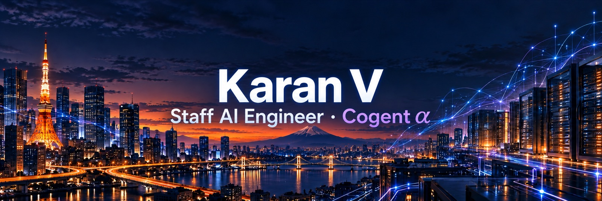

**Engineering Lead at Cogent ⍺ (Cogent Labs) · AI Infrastructure · ex-Platform / SRE · Tokyo 🇯🇵**

---

### ⚡ TL;DR

- 🏗️ **SRE → Platform → AI.** SRE at FourKites, Rapyuta Robotics and Sales Marker, then Senior Platform Engineer and now **Staff AI Engineer** at Cogent Labs
- 🏆 **LeetCode #191 globally** (contest #193, Guardian, Top 0.02%) · **#2 globally** on [Advent of Code 2023, Day 15](https://adventofcode.com/2023/leaderboard/day/15)
- 🎓 B.Tech CSE (AI & ML), **Top 1%** of my university · 🦀 Rust at heart · 💬 English · Tamil · French

### 🧰 Stack

<b>AI coding agents</b> 

### 🌍 Open Source Contributions

-  **[langchain](https://github.com/langchain-ai/langchain)**  · [Run Llama and newer models through Petals, not only Bloom](https://github.com/langchain-ai/langchain/pull/8356)
-  **[coolify](https://github.com/coollabsio/coolify)**  · [Pull request deployments via webhooks](https://github.com/coollabsio/coolify/pull/5444)
-  **[helm](https://github.com/helm/helm)**  · [Fix GO-2026-5932 by migrating provenance to ProtonMail/go-crypto](https://github.com/helm/helm/pull/32463)
-  **[WLED](https://github.com/wled/WLED)**  · [ESP32-C6 GPIO validation on ESP-IDF v5](https://github.com/wled/WLED/pull/5114)
-  **[coredns](https://github.com/coredns/coredns)**  · [Skip zone serial bumps on DNS-neutral pod updates](https://github.com/coredns/coredns/pull/8338)
-  **[karpenter](https://github.com/kubernetes-sigs/karpenter)**  · [Relax minValues against narrowed NodeClaim requirements](https://github.com/kubernetes-sigs/karpenter/pull/3170)

### 🏆 Competitive Programming

<a href="https://leetcode.com/u/karanVk/">
<picture>
  <source media="(prefers-color-scheme: dark)" srcset="https://leetcard.jacoblin.cool/karanVk?theme=dark&font=Fira_Code&ext=contest">
  
</picture>
</a>

<b>📊 GitHub stats</b>

 

<picture>
  <source media="(prefers-color-scheme: dark)" srcset="https://github-profile-summary-cards.vercel.app/api/cards/stats?username=karan-vk&theme=tokyonight">
  
</picture>
<picture>
  <source media="(prefers-color-scheme: dark)" srcset="https://github-profile-summary-cards.vercel.app/api/cards/most-commit-language?username=karan-vk&theme=tokyonight">
  
</picture>
<picture>
  <source media="(prefers-color-scheme: dark)" srcset="https://streak-stats.demolab.com/?user=karan-vk&theme=tokyonight&hide_border=true">
  
</picture>

<b>💼 Experience</b>

 

| Role | Company | Period |
| :-- | :-- | :-- |
| **Staff AI Engineer** · Engineering Lead, Cogent ⍺ · AI infrastructure | Cogent Labs, Tokyo | Present |
| Senior Platform Engineer · AI infrastructure | Cogent Labs, Tokyo | 03/2026 – promoted |
| Site Reliability Engineer | Sales Marker, Tokyo | 12/2024 – 02/2026 |
| Site Reliability Engineer / InfraOps | Rapyuta Robotics, Tokyo | 02/2024 – 11/2024 |
| Site Reliability Engineer | FourKites, Chennai | 07/2023 – 02/2024 |
| SRE Intern | FourKites, Chennai | 08/2022 – 06/2023 |
| Blockchain Developer Intern | IntelliConnect Technologies, Mumbai | 11/2021 – 04/2022 |
| Software Developer Intern | Fleo.IO, Bengaluru | 09/2021 – 11/2021 |
| Software Developer Intern | SBNA Technology, Coimbatore | 04/2020 – 01/2021 |

<b>🎓 Education, awards & certifications</b>

 

**B.Tech. Computer Science Engineering (AI & ML)**, Sri Ramachandra Institute, Chennai · 2023 · CGPA 9.33 (Top 1%)

**Awards:** #2 globally, [Advent of Code 2023 Day 15](https://adventofcode.com/2023/leaderboard/day/15) (both stars) · 3× winner, NeoPat Coding Contest · Runner-up, Hack at SRET

**Certifications:** Deep Learning · Machine Learning (Stanford Online) · MLOps · NLP · Mathematics for ML · TensorFlow Developer · ML on Google Cloud · Functional Programming in Scala · Julia Scientific Programming (Honors)

<b>🛠️ Full toolbox</b>

 

 

